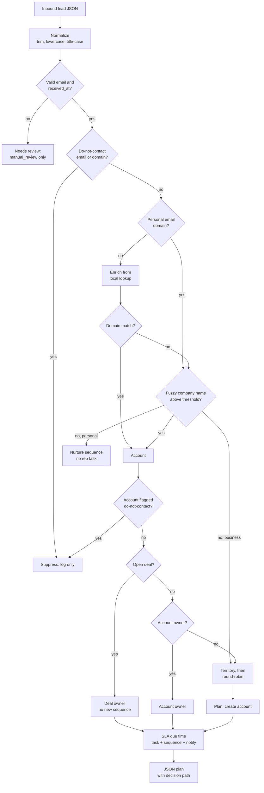

<picture>
  <source media="(prefers-color-scheme: dark)" srcset=".github/banner-dark.svg">
  
</picture>

<p>
  <a href="https://github.com/erickNjuki/inbound-lead-router/actions/workflows/tests.yml"></a>
  
  
  
</p>

<h1 align="left">inbound-lead-router</h1>

A small, dependency-free Python engine that decides **who should follow up on an inbound lead, how fast, and what should happen next**, and explains every one of those decisions in writing.

You give it a lead (a form fill, a demo request, a content download). It cleans the data, checks whether you are even allowed to contact the person, finds the company in your account list, protects live deals from being poached, picks an owner, computes a response deadline (SLA), and returns a **plan**: a JSON list of actions such as "create a task for Jordan Kim due at 14:18" or "enroll in the Demo follow-up sequence". It never touches a CRM itself. A separate worker (or a person) executes the plan.

## Contents

- [Contents](#contents)
- [Why this exists](#why-this-exists)
- [Quickstart](#quickstart)
- [How a lead is routed](#how-a-lead-is-routed)
- [Input: the lead](#input-the-lead)
- [Output: the plan](#output-the-plan)
- [The guards](#the-guards)
- [Configuration](#configuration)
  - [`data/routing.json`: the rules](#dataroutingjson-the-rules)
  - [`data/accounts.json`: existing accounts](#dataaccountsjson-existing-accounts)
  - [`data/enrichment.json`: firmographics by domain](#dataenrichmentjson-firmographics-by-domain)
- [CLI reference](#cli-reference)
- [Sample output](#sample-output)
- [Design decisions](#design-decisions)
- [Connecting it to a real CRM](#connecting-it-to-a-real-crm)
- [Tests](#tests)
- [Project layout](#project-layout)
- [Limitations](#limitations)

## Why this exists

Inbound routing looks simple ("send the lead to the right rep") until it hits real data. Most routing breaks in the same handful of ways:

- **Speed.** A demo request answered in 15 minutes converts far better than one answered tomorrow, so every lead needs an owner _and_ a deadline.
- **Deals get stepped on.** Someone at a company with a live opportunity fills in a form, territory rules send it to a different rep, and now two reps are emailing the same buyer.
- **Opt-outs get ignored.** A person or company that asked not to be contacted gets enrolled in a sequence because the check ran after matching, or missed a `+tag` or a subdomain.
- **Free-mail domains poison matching.** If `gmail.com` is treated like a company domain, every Gmail lead "matches" the same account.
- **Bad hints cause bad merges.** A stale CRM id in a hidden form field attaches a lead to the wrong company.
- **Nobody can explain the result.** When a rep asks "why did this lead go to them?", the answer is buried in workflow history.

This project handles each of those explicitly, as a named guard with a test, and writes the reasoning into the output.

## Quickstart

Requires Python 3.10+ and nothing else. `pytest` is only needed for the tests.

```bash
git clone https://github.com/erickNjuki/inbound-lead-router && cd inbound-lead-router

python -m router samples/leads/*.json --text                  # readable decision path for each sample lead
python -m router samples/leads/02_open_deal_other_owner.json  # the JSON plan for one lead
python -m pytest -q                                           # run the test suite
```

On Windows, use `python` instead of `python3`.

Nothing is written to disk by default. The only state the router keeps is the round-robin pointer, and it is saved only when you pass `--commit` (to `state/round_robin.json`).

## How a lead is routed



Every lead goes through the same stages, in this order. Each stage appends one line to the plan's `decision_path`, so the output is a step-by-step log of the run.

1. **Normalize.** Trim whitespace, lowercase the email, title-case the name (`dana` `LEE` becomes `Dana Lee`), collapse spaces in the company name, and default a missing `source` to `contact_sales`. The email domain is extracted here.
2. **Validate.** The lead needs a well-formed email and a `received_at` timestamp in ISO 8601 _with a timezone_. Without them there is no way to identify the person or compute an SLA, so the lead goes to `needs_review` instead of getting a made-up owner.
3. **Do-not-contact check.** Runs before any lookup, so an opted-out person is never matched, enriched or assigned. It compares the email with and without a `+tag`, and the domain together with all of its parent domains.
4. **Resolve the source.** The `source` decides the SLA and the follow-up sequence. An unknown source falls back to `contact_sales`, and the decision path says so, so a newly added form doesn't silently get the wrong SLA.
5. **Personal email check and enrichment.** For a free-mail domain (`gmail.com`, `yahoo.com`, ...), domain matching and enrichment are skipped. For a business domain, the router looks up firmographics (company, region, headcount, industry) in the local enrichment table, walking up subdomains, and fills in a blank company name from the result.
6. **Match an account.** First by exact domain, then by parent domain (`mail.fabrikam.example` finds `fabrikam.example`), then by fuzzy company name. Names are compared after removing punctuation and suffixes such as `Inc`, `LLC` and `GmbH`, and a match needs a similarity of at least `name_match_threshold` (0.88). A `crm_account_id` on the lead is never enough on its own and is logged as ignored.
7. **Account guards and assignment.**
   - Account flagged do-not-contact: suppress.
   - Account has an open deal: route to the **deal owner**, even if a different rep owns the account, and do not start a new sequence.
   - Account has an owner: route to the account owner.
   - Account has no owner: assign by territory.
   - No account, personal email: nurture sequence only, no rep task.
   - No account, business email: assign by territory and plan a `create_account`.
8. **Territory and round-robin.** Territories are checked top to bottom and the first one that fits wins (a `min_employees` floor and/or a list of `regions`). Within the territory, the owner is picked round-robin from its pool. If no territory fits, the `fallback_pool` is used.
9. **SLA and plan.** The due time is `received_at` plus the source's `sla_minutes`. The plan then gets a `create_task` for the owner, an `enroll_sequence` (skipped for open deals), and a `notify` message.

The router code is in [`router/route.py`](router/route.py). The function `route()` follows these steps from top to bottom.

## Input: the lead

One JSON object per file:

```json
{
  "email": "  Dana.Lee@Northwind-Logistics.example ",
  "first_name": "dana",
  "last_name": "LEE",
  "company": "Northwind Logistics",
  "source": "demo_request",
  "received_at": "2025-06-02T14:03:00Z",
  "crm_account_id": null
}
```

| Field                     | Required | Notes                                                                         |
| ------------------------- | -------- | ----------------------------------------------------------------------------- |
| `email`                   | yes      | Trimmed and lowercased. Invalid or missing sends the lead to manual review.   |
| `received_at`             | yes      | ISO 8601 with a timezone (`Z` or `+02:00`). Used to compute the SLA due time. |
| `first_name`, `last_name` | no       | Title-cased and used in the task title. Falls back to the email.              |
| `company`                 | no       | Used for fuzzy matching. Filled in from enrichment when blank.                |
| `source`                  | no       | Key into `sources` in `routing.json`. Defaults to `contact_sales`.            |
| `crm_account_id`          | no       | Treated as a hint only. Logged, never used to match by itself.                |

## Output: the plan

```json
{
  "outcome": "routed_to_deal_owner",
  "owner": "Morgan Avery",
  "account_id": "A-102",
  "sla_due": "2025-06-02T16:20:00Z",
  "decision_path": ["..."],
  "actions": [{ "type": "create_task", "...": "..." }],
  "lead": { "...": "the normalized lead, plus enrichment if any" }
}
```

When you pass several files, the CLI prints a JSON array of plans.

**Outcomes**

| `outcome`                 | Meaning                                    | Owner                 |
| ------------------------- | ------------------------------------------ | --------------------- |
| `routed_to_account_owner` | Matched an account that has an owner       | Account owner         |
| `routed_to_deal_owner`    | Matched an account with an open deal       | Deal owner            |
| `routed_by_territory`     | Matched an account with no owner           | Territory round-robin |
| `new_account`             | Business email, no matching account        | Territory round-robin |
| `nurture`                 | Personal email, no matching account        | none                  |
| `suppressed`              | Do-not-contact (person, domain or account) | none                  |
| `needs_review`            | Missing/invalid email or timestamp         | none                  |

**Action types**

| `type`            | Fields                        | When                                                |
| ----------------- | ----------------------------- | --------------------------------------------------- |
| `create_account`  | `domain`, `name`, `owner`     | `new_account`                                       |
| `create_task`     | `owner`, `due`, `title`       | Every routed lead                                   |
| `enroll_sequence` | `sequence`, `email`, `sender` | Routed leads except open deals; nurture (no sender) |
| `notify`          | `to`, `message`               | Every routed lead                                   |
| `log_only`        | `reason`                      | `suppressed`                                        |
| `manual_review`   | `reason`                      | `needs_review`                                      |

## The guards

| Guard                          | What it stops                                                                                 | Result                                                                                                                                                       |
| ------------------------------ | --------------------------------------------------------------------------------------------- | ------------------------------------------------------------------------------------------------------------------------------------------------------------ |
| Invalid lead                   | A lead with no usable email or no timezone-aware `received_at` getting a made-up owner or SLA | Checked first. Outcome `needs_review`, plan is `manual_review`.                                                                                              |
| Do-not-contact email or domain | Any outreach to someone who opted out                                                         | Checked before any lookup. `+tags` are ignored (`no-sales+promo@` still matches `no-sales@`) and a blocked domain covers its subdomains. Plan is `log_only`. |
| Do-not-contact account         | Outreach to a company that asked to be left alone                                             | `log_only`, no owner                                                                                                                                         |
| Open deal                      | A second rep starting a parallel conversation on a live deal                                  | Routes to the deal owner, even when the account owner is someone else. No new sequence.                                                                      |
| Personal email domain          | `gmail.com` matching every other Gmail lead, or enriching a free-mail domain                  | Skips domain match and enrichment, tries the company name, otherwise nurture                                                                                 |
| Unknown source                 | A new form source quietly getting the wrong SLA                                               | Falls back to `contact_sales` and writes that into the decision path                                                                                         |
| ID hint without evidence       | A stale CRM id on a form merging a lead into the wrong account                                | The hint is logged and ignored. Only domain or name evidence makes a match.                                                                                  |

Domain matching and enrichment walk up subdomains, so `mail.fabrikam.example` matches the `fabrikam.example` account and isn't created again as a duplicate.

## Configuration

All data lives in `data/` as plain JSON. The accounts and enrichment records are fabricated examples; in production they would come from your CRM and enrichment provider.

### `data/routing.json`: the rules

| Key                                  | What it controls                                                                                                    |
| ------------------------------------ | ------------------------------------------------------------------------------------------------------------------- |
| `name_match_threshold`               | Minimum fuzzy-name similarity (0 to 1) to count as a match. Default `0.88`.                                         |
| `personal_domains`                   | Free-mail domains that skip domain matching and enrichment.                                                         |
| `do_not_contact.emails` / `.domains` | Opted-out addresses and blocked domains (subdomains included).                                                      |
| `territories`                        | Ordered list. Each has a `name`, a `pool` of reps, and optionally `min_employees` and/or `regions`. First fit wins. |
| `fallback_pool`                      | Reps (or a queue) used when no territory fits.                                                                      |
| `sources`                            | Per form source: `sla_minutes` and the `sequence` to enroll in. Must include `contact_sales`.                       |
| `nurture_sequence`                   | Sequence for personal-email leads that match no account.                                                            |

With the shipped config, a company of 1,000+ employees goes to the `enterprise` territory regardless of region, because that territory is listed first.

The CLI validates this file on load and exits with code 2 if something would break routing partway through a batch: a missing key, a threshold outside (0, 1], no `contact_sales` source, a source without a positive SLA or a sequence, an empty pool, or duplicate territory names (they key the round-robin state).

### `data/accounts.json`: existing accounts

```json
{
  "id": "A-102",
  "name": "Contoso Health",
  "domain": "contosohealth.example",
  "owner": "Riley Chen",
  "region": "US-West",
  "employees": 2400,
  "do_not_contact": false,
  "open_deal": { "id": "D-2207", "stage": "proposal", "owner": "Morgan Avery" }
}
```

`owner` and `open_deal` may be `null`.

### `data/enrichment.json`: firmographics by domain

```json
{
  "lucernefreight.example": {
    "company": "Lucerne Freight",
    "region": "US-East",
    "employees": 300,
    "industry": "Logistics"
  }
}
```

A stand-in for an enrichment API (Clearbit, Apollo, ZoomInfo and so on). `region` and `employees` drive territory assignment for new accounts.

## CLI reference

```text
python3 -m router LEAD.json [LEAD.json ...] [--text] [--commit] [--data DIR] [--state FILE]
```

| Option         | Effect                                                                                           |
| -------------- | ------------------------------------------------------------------------------------------------ |
| `--text`       | Print the readable decision path instead of JSON                                                 |
| `--commit`     | Save the round-robin pointer after planning                                                      |
| `--data DIR`   | Read `routing.json`, `accounts.json` and `enrichment.json` from another folder (default `data/`) |
| `--state FILE` | Round-robin state file (default `state/round_robin.json`)                                        |

**Exit codes:** `0` all leads planned, `1` at least one lead file was unreadable or not a JSON object (the rest of the batch still runs, errors go to stderr), `2` the config or data files failed to load or validate.

## Sample output

The six sample leads in `samples/leads/` each take a different path through the router:

| Sample                             | Path it exercises                                                             |
| ---------------------------------- | ----------------------------------------------------------------------------- |
| `01_demo_request_existing_account` | Domain match, routed to account owner, 15-minute SLA                          |
| `02_open_deal_other_owner`         | Open-deal guard overrides the account owner                                   |
| `03_personal_email_fuzzy_name`     | Gmail address, matched by a misspelled company name (`Fabricam` ~ `Fabrikam`) |
| `04_personal_email_no_company`     | Gmail address, no company: nurture only                                       |
| `05_do_not_contact_account`        | Account flagged do-not-contact: suppressed                                    |
| `06_new_company_stale_id_hint`     | Unknown company with a misleading `crm_account_id`: new account via territory |

<details>
<summary>Full <code>--text</code> output for all six</summary>

```text
$ python3 -m router samples/leads/*.json --text
== 01_demo_request_existing_account.json
   normalize dana.lee@northwind-logistics.example | company 'Northwind Logistics' | source demo_request
   enrich    Northwind Logistics | US-East | 820 employees | Logistics
   match     domain northwind-logistics.example = A-100 Northwind Logistics
   assign    account owner Jordan Kim
   sla       demo_request = 15 min, due 2025-06-02T14:18:00Z
   -> routed_to_account_owner, owner Jordan Kim
   would create_task: owner=Jordan Kim, due=2025-06-02T14:18:00Z, title=Respond to demo request: Dana Lee
   would enroll_sequence: sequence=Demo follow-up, email=dana.lee@northwind-logistics.example, sender=Jordan Kim
   would notify: to=Jordan Kim, message=New demo_request from dana.lee@northwind-logistics.example, respond by 2025-06-02T14:18:00Z

== 02_open_deal_other_owner.json
   normalize it-lead@contosohealth.example | company 'Contoso Health' | source contact_sales
   enrich    Contoso Health | US-West | 2400 employees | Healthcare
   match     domain contosohealth.example = A-102 Contoso Health
   guard     open deal D-2207 (proposal) owned by Morgan Avery, not account owner Riley Chen: route to deal owner
   sla       contact_sales = 60 min, due 2025-06-02T16:20:00Z
   plan      active deal: no new sequence, the deal owner follows up by hand
   -> routed_to_deal_owner, owner Morgan Avery
   would create_task: owner=Morgan Avery, due=2025-06-02T16:20:00Z, title=Respond to contact sales: Avery Stone
   would notify: to=Morgan Avery, message=New contact_sales from it-lead@contosohealth.example, respond by 2025-06-02T16:20:00Z

== 03_personal_email_fuzzy_name.json
   normalize pat.morgan@gmail.com | company 'Fabricam Robotics Inc' | source demo_request
   guard     personal email domain gmail.com: skip domain match and enrichment
   match     name 'Fabricam Robotics Inc' ~ A-103 Fabrikam Robotics (similarity 0.94 >= 0.88)
   assign    account owner Jordan Kim
   sla       demo_request = 15 min, due 2025-06-02T17:00:00Z
   -> routed_to_account_owner, owner Jordan Kim
   would create_task: owner=Jordan Kim, due=2025-06-02T17:00:00Z, title=Respond to demo request: Pat Morgan
   would enroll_sequence: sequence=Demo follow-up, email=pat.morgan@gmail.com, sender=Jordan Kim
   would notify: to=Jordan Kim, message=New demo_request from pat.morgan@gmail.com, respond by 2025-06-02T17:00:00Z

== 04_personal_email_no_company.json
   normalize lee.w@yahoo.com | company '' | source content_download
   guard     personal email domain yahoo.com: skip domain match and enrichment
   assign    personal email with no company match: nurture, no rep task
   -> nurture, owner None
   would enroll_sequence: sequence=Newsletter nurture, email=lee.w@yahoo.com

== 05_do_not_contact_account.json
   normalize ops@tailspintravel.example | company 'Tailspin Travel' | source demo_request
   enrich    no enrichment record for tailspintravel.example
   match     domain tailspintravel.example = A-104 Tailspin Travel
   guard     account A-104 is flagged do-not-contact: suppress all outreach
   -> suppressed, owner None
   would log_only: reason=account A-104 is flagged do-not-contact

== 06_new_company_stale_id_hint.json
   normalize chris@lucernefreight.example | company 'Lucerne Freight' | source demo_request
   enrich    Lucerne Freight | US-East | 300 employees | Logistics
   match     no account with domain lucernefreight.example
   match     closest name Litware Analytics at 0.31 is under 0.88, no match
   match     ignored account id hint A-100: no domain or name evidence
   assign    territory east-central -> round-robin Jordan Kim (pool of 2)
   sla       demo_request = 15 min, due 2025-06-02T18:25:00Z
   -> new_account, owner Jordan Kim
   would create_account: domain=lucernefreight.example, name=Lucerne Freight, owner=Jordan Kim
   would create_task: owner=Jordan Kim, due=2025-06-02T18:25:00Z, title=Respond to demo request: Chris Hale
   would enroll_sequence: sequence=Demo follow-up, email=chris@lucernefreight.example, sender=Jordan Kim
   would notify: to=Jordan Kim, message=New demo_request from chris@lucernefreight.example, respond by 2025-06-02T18:25:00Z
```

</details>

<details>
<summary>Lead 02 as the JSON plan a downstream worker would execute</summary>

```json
{
  "outcome": "routed_to_deal_owner",
  "owner": "Morgan Avery",
  "account_id": "A-102",
  "sla_due": "2025-06-02T16:20:00Z",
  "decision_path": [
    "normalize it-lead@contosohealth.example | company 'Contoso Health' | source contact_sales",
    "enrich    Contoso Health | US-West | 2400 employees | Healthcare",
    "match     domain contosohealth.example = A-102 Contoso Health",
    "guard     open deal D-2207 (proposal) owned by Morgan Avery, not account owner Riley Chen: route to deal owner",
    "sla       contact_sales = 60 min, due 2025-06-02T16:20:00Z",
    "plan      active deal: no new sequence, the deal owner follows up by hand"
  ],
  "actions": [
    {
      "type": "create_task",
      "owner": "Morgan Avery",
      "due": "2025-06-02T16:20:00Z",
      "title": "Respond to contact sales: Avery Stone"
    },
    {
      "type": "notify",
      "to": "Morgan Avery",
      "message": "New contact_sales from it-lead@contosohealth.example, respond by 2025-06-02T16:20:00Z"
    }
  ],
  "lead": {
    "email": "it-lead@contosohealth.example",
    "domain": "contosohealth.example",
    "name": "Avery Stone",
    "company": "Contoso Health",
    "source": "contact_sales",
    "received_at": "2025-06-02T15:20:00Z",
    "crm_account_id": null,
    "enrichment": {
      "company": "Contoso Health",
      "region": "US-West",
      "employees": 2400,
      "industry": "Healthcare"
    }
  }
}
```

</details>

## Design decisions

- **Plan, then act.** The router returns what it would do and never calls a CRM. A separate worker executes the plan. That makes every routing change testable against real leads with zero risk, and the same plan can be reviewed by a person before anything goes live.
- **Never merge on IDs alone.** A hidden form field or a copied CRM id is the easiest way to attach a lead to the wrong company. A match needs a domain or a company name above a similarity threshold. The threshold (0.88) sits high on purpose: a missed match costs a duplicate someone can merge later, a wrong match puts a prospect in another rep's deal.
- **Guards run in a fixed order.** Do-not-contact comes before everything, so an opted-out person is never even matched. The open-deal check comes before territory, so a live deal always beats the map.
- **The decision path is part of the output.** Each step adds one line. When a rep asks "why did this lead go to them?", the answer is in the plan, not in someone's memory of the workflow.
- **Round-robin state only moves on commit.** Planning the same lead twice gives the same owner, so dry runs do not quietly skew the rotation. Within a single batch the rotation still advances, so a batch of leads is spread across the pool.
- **Config errors fail fast.** A bad `routing.json` stops the run before the first lead, instead of crashing on lead 40 of 100 and leaving a half-processed batch.

## Connecting it to a real CRM

The router is the decision layer. To use it in production you add the two ends around it:

1. **Feed it data.** Replace the JSON files in `data/` with exports or live reads from your CRM (accounts, owners, open opportunities, do-not-contact flags) and your enrichment provider. The router only needs the fields shown above.
2. **Call `route()` per lead.** From a webhook or queue consumer, build a `Context` once and call `route(lead, ctx)` for each incoming lead. It returns a `Plan`; `plan.as_dict()` gives the JSON shown above.
3. **Execute the plan.** A worker maps each action `type` to a CRM API call (Salesforce, HubSpot and so on): `create_account`, `create_task`, `enroll_sequence`, `notify` (Slack or email), `log_only`, and `manual_review` (a review queue). Persist `ctx.rr_state` after each lead so the rotation survives restarts.

```python
from pathlib import Path
from router.__main__ import load_context
from router.route import route

ctx = load_context(Path("data"), Path("state/round_robin.json"))
plan = route({"email": "dana.lee@northwind-logistics.example", "source": "demo_request",
              "received_at": "2025-06-02T14:03:00Z"}, ctx)
print(plan.outcome, plan.owner, plan.sla_due)
```

## Tests

```bash
python3 -m pytest -q
```

The suite in [`tests/test_router.py`](tests/test_router.py) has one test per guard, plus tests for normalization, domain vs. name matching, subdomain handling, round-robin rotation, territory fallback, SLA math, config validation, and CLI error handling (including that plan mode writes no state). CI runs it on Python 3.10 to 3.13 and also runs the quickstart against every sample lead.

## Project layout

```text
data/accounts.json      existing accounts, owners, open deals, DNC flags (fabricated)
data/enrichment.json    local enrichment lookup by domain
data/routing.json       threshold, guards, territories, SLAs, sequences
router/route.py         normalize, enrich, match, guards, assign, plan
router/__main__.py      CLI, config validation, data loading
samples/leads/          six leads, one per path
tests/                  guards, matching, SLA, round-robin, config and CLI errors
```

## Limitations

- Fuzzy matching uses Python's `difflib` against every account, which is fine for thousands of accounts but not millions. A production version would pre-filter candidates or use a search index.
- Enrichment is a local lookup table, not a live API call.
- Round-robin is a simple rotation. It doesn't account for rep capacity, time off or working hours.
- SLAs are wall-clock minutes from `received_at`. They don't pause outside business hours or on weekends.
